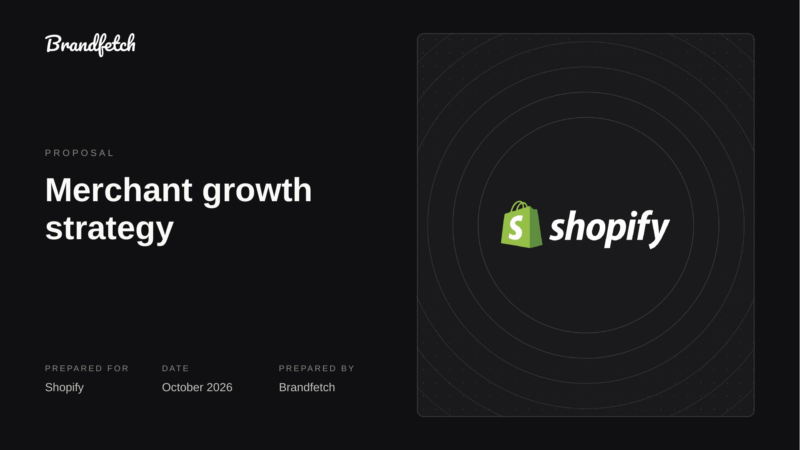
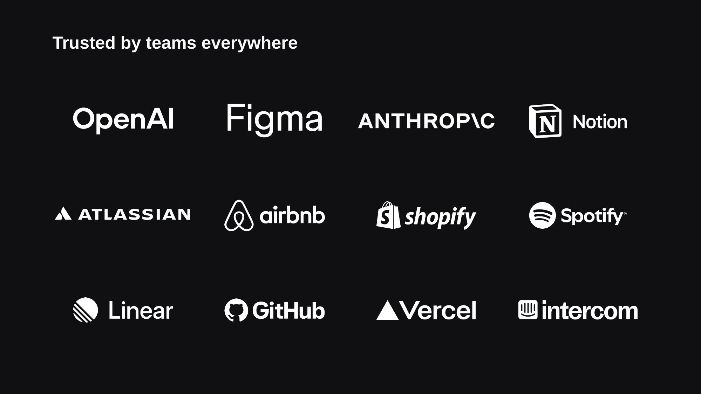

# Brandfetch skills

Agent skills powered by the [Brandfetch](https://brandfetch.com) MCP, packaged
as the official Brandfetch plugin for Claude Code and claude.ai. The plugin
bundles two things:

1. **The Brandfetch MCP server** — search 50M+ brands and retrieve logos,
   icons, colors, fonts, company data and LLM-ready brand context.
2. **Skills** that turn that data into finished, on-brand deliverables.

| Skill | What it does | Try |
|---|---|---|
| [`pitch-deck-generator`](skills/pitch-deck-generator/) | Fill **your own** PPTX template with a client's brand data and your deal values | *"Make a proposal deck for stripe.com"* |
| [`logo-wall`](skills/logo-wall/) | A "trusted by" wall as PPTX, PDF, HTML or PNG — logos pixel-verified, optically balanced, knockouts kept in monochrome | *"Logo wall of our 12 customers, white on dark"* |




## Install

### Claude Code

From the official plugin directory (once listed):

```
/plugin install brandfetch
```

Or straight from this repository:

```
/plugin marketplace add Brandfetch/skills
/plugin install brandfetch@brandfetch
```

The first time a Brandfetch tool is used, Claude Code opens the Brandfetch
OAuth flow in your browser. Alternatively, generate a `bf1.` MCP token from
**Keys and MCP** in the [Brandfetch dashboard](https://developers.brandfetch.com)
and connect the server manually with an `Authorization: Bearer` header — see the
[MCP docs](https://docs.brandfetch.com/mcp/overview).

Skills are invoked as `/brandfetch:pitch-deck-generator` and
`/brandfetch:logo-wall`, or automatically when the conversation calls for them.

### claude.ai

Add **Brandfetch** from the connector directory (Settings → Connectors), then
add the skills you want from **Settings → Capabilities → Skills** by uploading
a zip of the skill folder. Team and Enterprise admins can instead distribute
this plugin to the whole organization from **Organization settings → Plugins**.

### Claude API

Upload a skill folder via the [Skills API](https://platform.claude.com/docs/en/agents-and-tools/agent-skills/overview)
(`/v1/skills`); requires the code execution tool.

## Requirements

- A Brandfetch account (free tier works) for the MCP server.
- **`cdn.brandfetch.io`** on your environment's network allowlist — the skills
  download logo files with `curl`. Allowlist changes apply to **new**
  conversations only.
- Python with `Pillow`. Nothing else: PPTX and PDF files are written directly.

Each skill's `references/setup.md` covers the setup traps in detail,
including the three different failures that all look like a 403.

## How the skills work

Both skills follow the same contract:

- **Two token namespaces.** `{bf:*}` tokens resolve automatically from the
  Brandfetch API (`{bf:name}`, `{bf:logo}`, …). Every other
  `{token}` is yours — named after whatever your business sells, supplied at
  build time, **never guessed**.
- **Never invent a fact.** Every value on a slide comes from the API or from
  the conversation. Missing data stays visibly missing.
- **Verify pixels, not metadata.** Logo theme labels don't guarantee a
  monochrome mark; the skills check the actual pixels and hunt alternate
  variants when they fail.
- **The output is real PowerPoint.** Every logo is a separate, movable
  picture. No rasterised slides.

## Make it yours

The deck skill is built to be forked. The bundled `assets/template.pptx` is a
reference showing where tokens go — replace it with **your** deck.

Attach your deck and say *set up my template*.

Claude finds what changes per client in a deck you already sent — their name,
logos, dates, fees — agrees the list with you, writes the template, and asks
before it replaces the bundled one. Or instrument it by hand:

1. Type tokens as visible text in your own template
   (`{bf:name}`, `{bf:logo}`, `{your_own_fields}`).
2. `python3 scripts/scan_template.py your-template.pptx` — fix every warning.
3. Build. Nothing about your template's layout is hardcoded.

Full guide: [`skills/pitch-deck-generator/references/template-guide.md`](skills/pitch-deck-generator/references/template-guide.md).

## Repository layout

```
.claude-plugin/plugin.json        plugin manifest
.claude-plugin/marketplace.json   lets `/plugin marketplace add Brandfetch/skills` work
.mcp.json                         the hosted Brandfetch MCP server
skills/pitch-deck-generator/      SKILL.md · assets/template.pptx · scripts/ · references/
skills/logo-wall/                 SKILL.md · scripts/ · references/
docs/                             example renders
```

## Links

- MCP server source: https://github.com/Brandfetch/brandfetch-mcp-server
- MCP documentation: https://docs.brandfetch.com/mcp/overview
- Brandfetch API: https://developers.brandfetch.com

## License

MIT — see [LICENSE](LICENSE).
